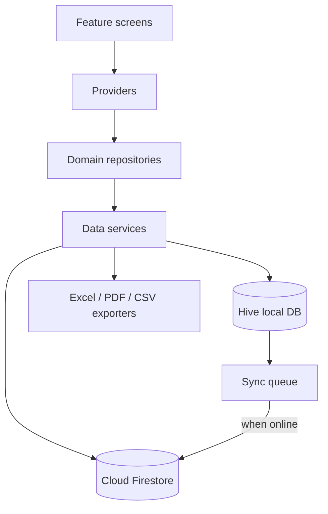

# POS Mobile System — Offline-First Point of Sale for a Poultry Shop

[](https://github.com/cantedavid00-afk/POS/actions/workflows/ci.yml)


A point-of-sale app for a local poultry business with more than one branch: sales, cash shifts, stock per branch, transfers, losses and management reports. It runs on Android phones and tablets, and also includes a desktop admin dashboard.

## Business Problem

Sales by cut, stock and employee shifts were tracked by hand. The owner had no reliable daily numbers, and the shop's internet connection is unstable.

## Solution

A Flutter app backed by Firebase, with a local Hive cache and a sync queue so sales keep working offline and upload when the connection returns. Reports export to Excel and PDF so the owner can review them outside the app.

## Key Features

- Owner login (Firebase Auth) and **employee access by PIN**.
- Business and **multi-branch** setup.
- Products with modifiers and presentations; sale screen with cart, tickets and receipts.
- **Cash shifts** (open/close), **inventory per branch**, stock transfers between branches and loss records.
- Poultry-specific modules: receiving chicken, cut recipes and anomaly detection in the butchering process.
- **Offline-first**: Hive local database, sync queue and connectivity monitoring.
- **Reports**: Excel workbooks with filters and summaries, PDF/printing, CSV export and charts.
- **Desktop admin dashboard** with KPIs, sales, products and poultry views.
- In-app changelog, version indicator, haptics and number/date/phone formatting utilities.

## Technology Stack

| Area | Technology |
|---|---|
| UI | Flutter (Android first; Windows desktop dashboard) |
| State / navigation | Provider (`ChangeNotifier`), `go_router` |
| Backend | Firebase Auth, Cloud Firestore (hierarchical per business), App Check, Crashlytics |
| Offline | Hive, `connectivity_plus` |
| Reports | `excel_community`, `pdf`, `printing`, `fl_chart` |
| Testing | `flutter_test`, `mocktail`, `fake_cloud_firestore` |
| CI | GitHub Actions (`flutter analyze` + `flutter test`) |

## Architecture

Feature-first, with `data / domain / ui` layers in each feature and shared infrastructure in `core/`.



```text
pos_flutter_firebase/lib/
  core/        DI, router, offline sync, logger, theme, Result type
  features/    auth, business, employees, shift, pos, sales, products,
               inventory, transfers, losses, poultry, butcher, settings, home
  shared/      models, providers, extensions, widgets, utils
pos_flutter_firebase/test/   unit and widget tests
```

## Running Locally

Requirements: Flutter (stable), Android SDK, and a Firebase project with Auth (email/password) and Firestore.

```bash
git clone https://github.com/cantedavid00-afk/POS.git
cd POS/pos_flutter_firebase
cp .env.example .env          # your Firebase values
flutter pub get
flutter run
flutter test
```

## Status

In active development (v1.0.6+). Release APKs are tagged `v1.0.4`–`v1.0.6`.
